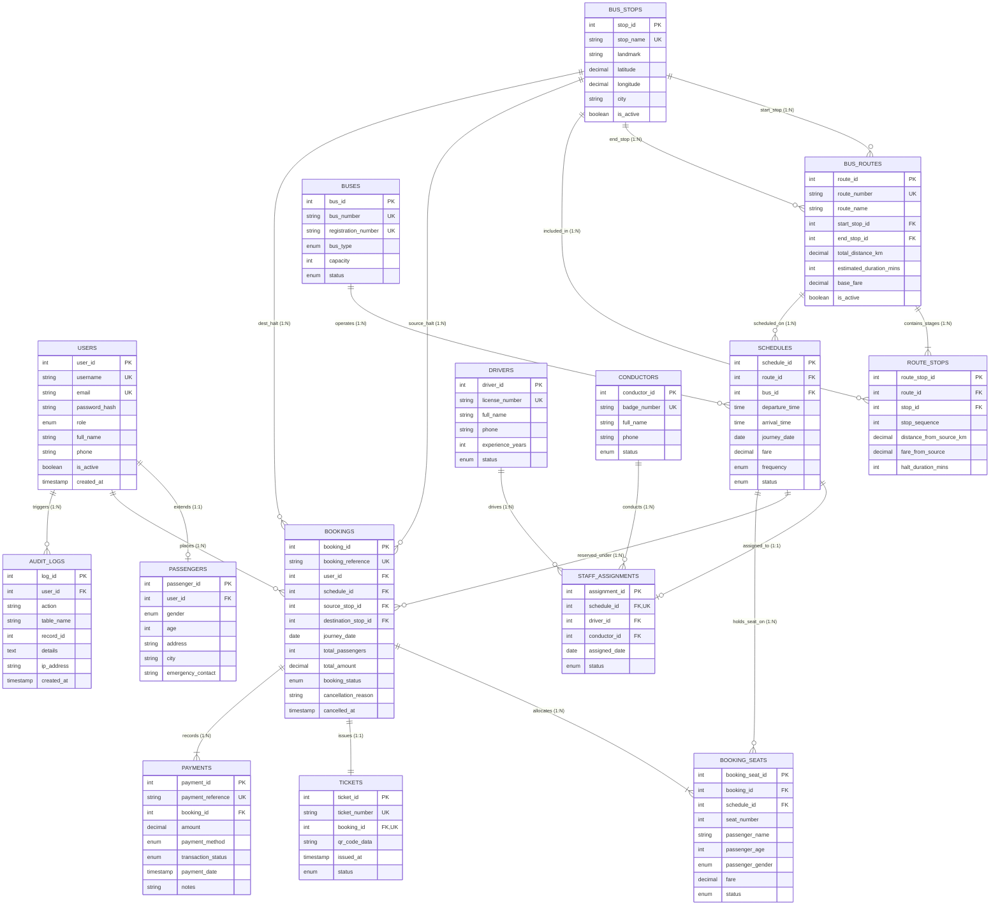

# Entity-Relationship (ER) Diagram
## City Bus Management System for Amravati (`city_bus_db`)

This document presents the relational Entity-Relationship model for the Amravati City Bus Management System. The diagram strictly matches the 15 normalized tables implemented in [`database/schema.sql`](file:///C:/Users/Balaji/.gemini/antigravity/scratch/CityBusManagementSystem/database/schema.sql).

---

## 1. Mermaid ER Diagram

---

## 2. Relational Cardinalities and Multiplicities

| Parent Entity | Child Entity | Relationship Type | Cardinality | Explanation |
|---|---|---|---|---|
| `users` | `passengers` | Extension | 1 : (0,1) | A user with role 'passenger' has exactly one profile extension. Admin users do not require a row in `passengers`. |
| `bus_stops` | `bus_routes` | Origin / Destination | 1 : N | A bus stop serves as the starting point or destination for multiple bus routes. |
| `bus_routes` | `route_stops` | Composition | 1 : N | A route consists of multiple ordered stop sequences. |
| `bus_stops` | `route_stops` | Participation | 1 : N | A stop appears in many routes at different sequence positions. |
| `buses` | `schedules` | Assignment | 1 : N | A physical bus vehicle operates multiple daily or weekly schedules over time. |
| `bus_routes` | `schedules` | Timetable | 1 : N | A route has multiple morning, afternoon, and evening departures. |
| `schedules` | `staff_assignments` | Crew Deployment | 1 : 1 | Each specific schedule has at most one active crew assignment. |
| `drivers` | `staff_assignments` | Crew Assignment | 1 : N | A driver operates multiple schedules across days. |
| `conductors` | `staff_assignments` | Crew Assignment | 1 : N | A conductor operates multiple schedules across days. |
| `users` | `bookings` | Customer Order | 1 : N | A registered passenger places zero, one, or many bus bookings. |
| `schedules` | `bookings` | Journey Booking | 1 : N | A scheduled departure accepts bookings until bus capacity is reached. |
| `bookings` | `booking_seats` | Seat Allocations | 1 : N | A booking contains one or more reserved passenger seat records. |
| `bookings` | `tickets` | Proof of Passage | 1 : 1 | Every confirmed booking receives exactly one ticket with secure QR string. |
| `bookings` | `payments` | Settlement | 1 : N | A booking has payment records (e.g., initial payment, refund upon cancellation). |
| `users` | `audit_logs` | Audit Trail | 1 : N | Administrative and booking actions link back to the acting user. |
