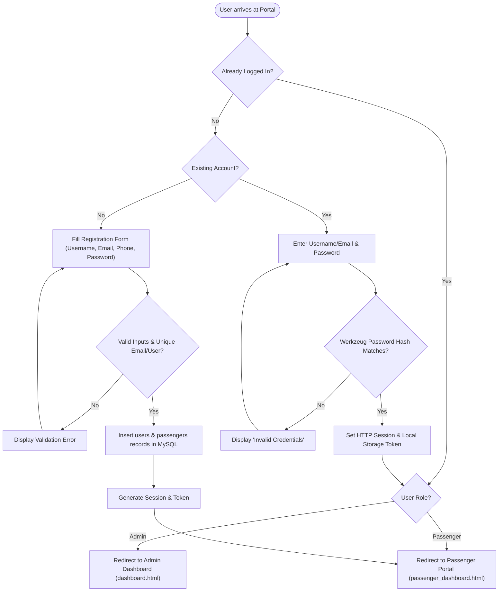
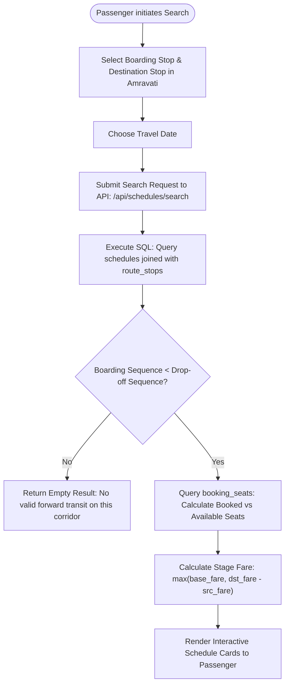
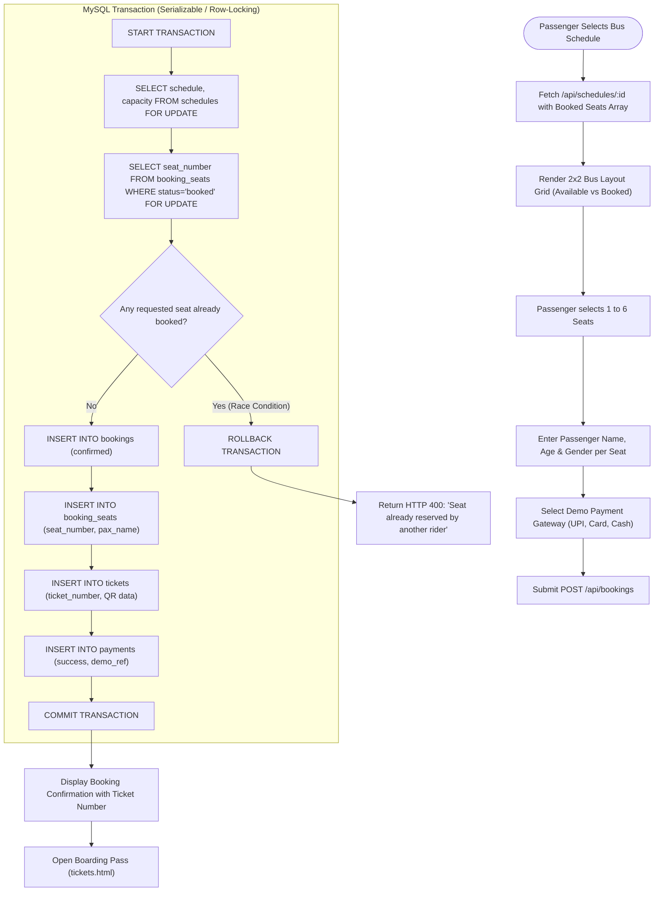
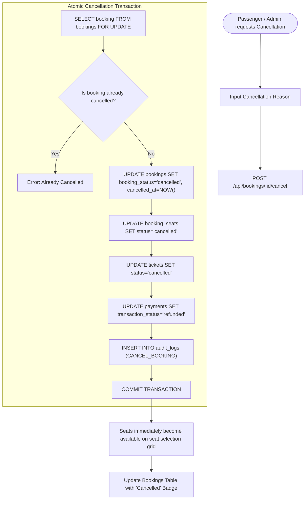

# System Flowcharts & Process Workflows
## City Bus Management System for Amravati

This document contains standard Mermaid process flowcharts illustrating the primary operations of the system.

---

## 1. User Authentication Flow

---

## 2. Route Search & Schedule Discovery Flow

---

## 3. ACID-Compliant Seat Booking & Concurrency Flow

---

## 4. Booking Cancellation & Seat Release Cycle

